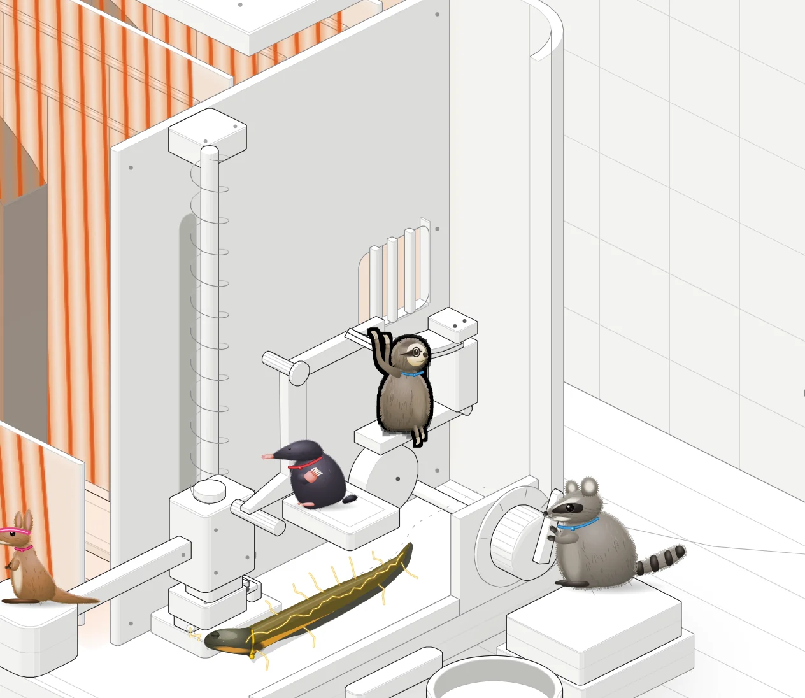
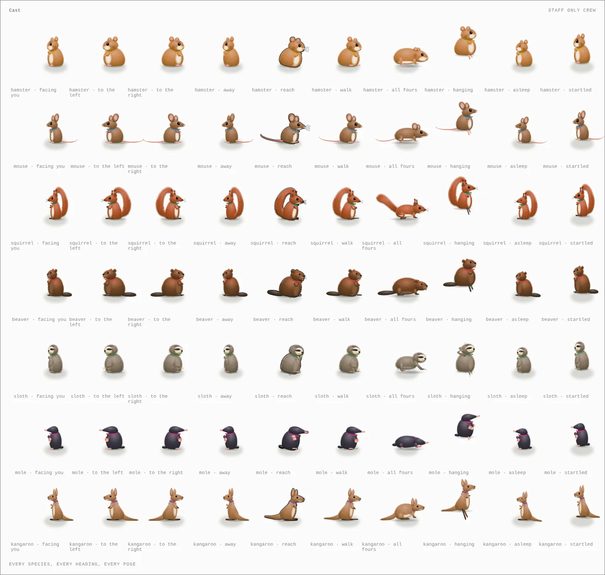

<h1 align="center">Staff Only</h1>

<p align="center"><b>A Claude skill that explains how a machine works by showing the crew of animals who secretly run it, as one continuous story.</b><br>A fork of <a href="https://github.com/wheresryan22/anatomy">Anatomy</a>: the same crafted isometric figures, kit and checks, with a crew of real animals inside, a full scene, and a run that plays the whole mechanism on a loop.</p>

<p align="center">
  
</p>

<p align="center"><sub><code>examples/toaster</code>, light theme, mid-toast. Mo feels the heat while Dig, Ember, Roo and Rocky hold their posts. Whoever is working is lit.</sub></p>

---

## The idea

Anatomy explains an idea by inventing a real machine whose working *is* the idea, then building it from dozens of small, solid, shaded parts. Staff Only keeps all of that and adds one thing: **the machine is real, the workforce is fake.** Every part that moves on its own has an operator, and the operator's motion is the part's motion. The hamsters' wheel is the motor, the crab's grip is the latch, the beaver's teeth are the blade.

Take the crew away and the mechanism is still true. Leave it in and people remember how the thing works.

## What's different from Anatomy

| | Anatomy | Staff Only |
|---|---|---|
| The one idea | The object is the explanation | The object is the explanation, and the crew is how it moves |
| Workflow | Size, truth, object, parts, world, geometry, order, frame, live, verify | Adds **cast the crew** after the parts list, and crew checks to verify |
| Colour | Monochrome, one lit accent | The machine and scene stay monochrome, as in Anatomy; colour is only on the animals (their fur, a collar in their role colour, their props) and on the light and heat the machine gives off, drawn with WebGL |
| Format | One interactive figure | A full scene played as one continuous story on a loop: the camera eases onto whoever is working, a caption per beat, no buttons and no stops |
| Lit accent | One part | One critter: the one whose part is moving (the part again when nothing moves) |
| Kit | `kit/` | `kit/` plus `kit/critters.mjs` (the crew: painted animals on a 2D rig, with their fur, role colours and props), `kit/steps.mjs` (the run) and `scripts/cast-sheet.mjs` |
| Examples | 8 | 12: adds `examples/toaster`, `examples/pencil-sharpener`, `examples/vending-machine` and `examples/dial-indicator-crew` |
| Gallery | Publishes to the Anatomy community gallery | Doesn't publish there |

Everything else, from the craft rules to the audit, the line check, WebGL, the 3D mode and printable sheets, is Anatomy's, unchanged. `ANATOMY-README.md` is Anatomy's own README, kept for reference.

## The crew

<p align="center"></p>

Eleven species ship: hamster, mouse, squirrel, beaver, sloth, mole, kangaroo, fennec fox, raccoon, otter and crab. Each is a painted illustration of the real animal (its silhouette, proportions, markings and fur, no outlines) on a rig that places it in the figure's camera, turns it to its heading and reaches its paws to the parts it works. Each wears a thin collar in its role colour:

| Role | Colour | Does |
|---|---|---|
| power | yellow | motors, current |
| holding | red | latches, clamps, brakes |
| cutting | violet | blades, cutters |
| sensing | blue | gauges, timers, switches that read |
| moving | green | carriages, rollers, feeders |
| heat | orange | heating elements |
| fluid | aqua | pumps, hoses, valves |
| spring | pink | springs, launchers |

Casting rule: the species' trait is the job. Claws grip, teeth cut, wheels run. One crew member per mechanism, so a detailed machine gets a bigger crew (up to seven).

Props say what each job is: hard hats, a miner's hat, a cap, a sweatband, glasses, goggles, a pencil behind the ear, a bow tie, a stopwatch, a whistle, oven mitts, a notebook or a clipboard. Cloth and plastic take the role colour. `references/crew.md` has the full rules, the props and how to add a species.

## Install

Staff Only is a standard [Agent Skill](https://agentskills.io): this folder, with `SKILL.md` at its root.

| For | Put this folder at |
|---|---|
| You, in Claude Code | `~/.claude/skills/staff-only` |
| One project, in Claude Code | `.claude/skills/staff-only` |
| OpenCode, Codex, Antigravity | that agent's skills folder, as in `ANATOMY-README.md` |

From a terminal, with this folder downloaded:

```sh
mkdir -p ~/.claude/skills && cp -R staff-only ~/.claude/skills/staff-only
```

Needs Node.js 20.10 or later for builds and Chrome or Chromium for the checks. Nothing to `npm install`.

## Usage

```text
/staff-only how a pop-up toaster knows when the toast is done
/staff-only a stapler, crewed, light theme, one HTML file
/staff-only explain a token bucket rate limiter, with a crew
```

Claude sizes the figure, finds the real numbers, invents (or uses) the machine, writes the parts list, the crew list and the beats, renders a cast sheet, builds the scene and the machine, poses the crew from the same model that moves the parts, plays the story on a loop, and checks every beat in both themes.

Try the examples:

```sh
node examples/toaster/build.mjs --light
open examples/toaster/toaster-light.html
node examples/pencil-sharpener/build.mjs --light
open examples/pencil-sharpener/pencil-sharpener-light.html
node examples/vending-machine/build.mjs --light
open examples/vending-machine/vending-machine-light.html
node scripts/cast-sheet.mjs --light
open cast-sheet-light.html
```

## Credits and license

Staff Only is built on [Anatomy](https://github.com/wheresryan22/anatomy) by Ryan ([skills.wheresryan.sh/anatomy](https://skills.wheresryan.sh/anatomy)), used under the MIT license. Anatomy's kit, examples, references and scripts are his work; the crew and the run (`kit/critters.mjs`, `kit/steps.mjs`, `scripts/cast-sheet.mjs`, `references/crew.md`, `references/steps.md`, `examples/toaster`, `examples/pencil-sharpener`, `examples/vending-machine`, `examples/dial-indicator-crew`) and the changes to `SKILL.md` are Staff Only's. See [LICENSE](LICENSE).
