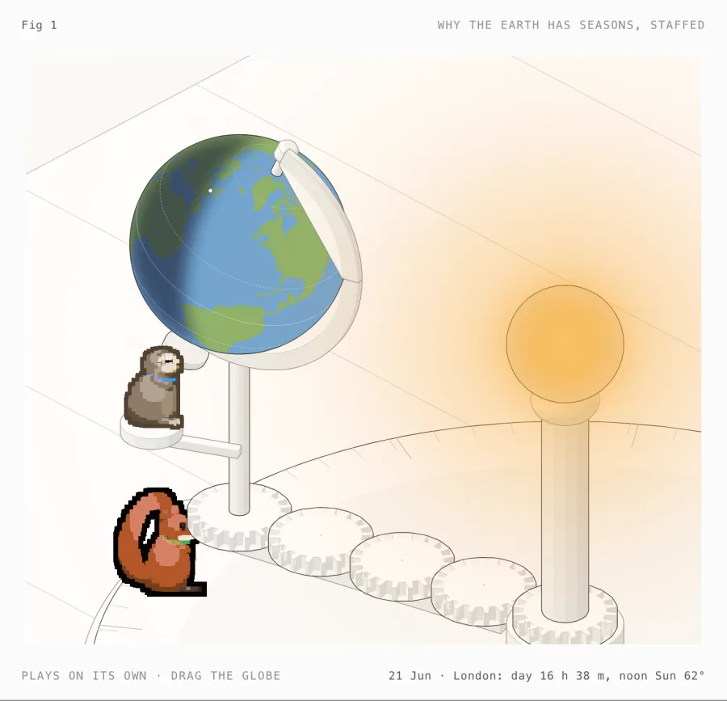
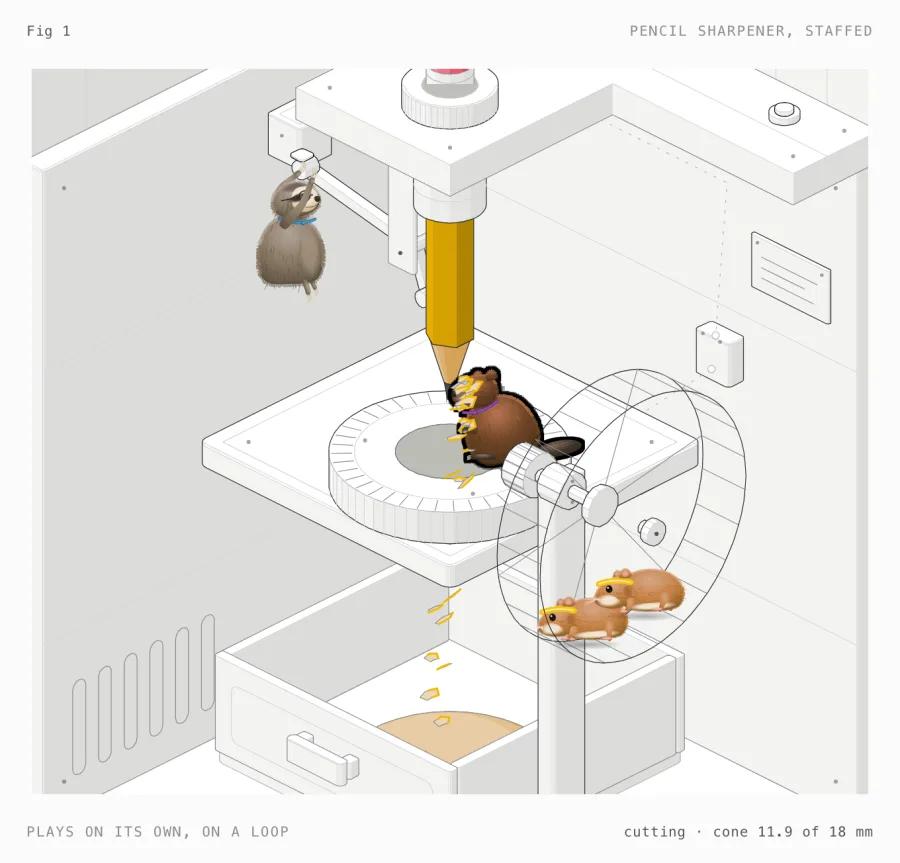
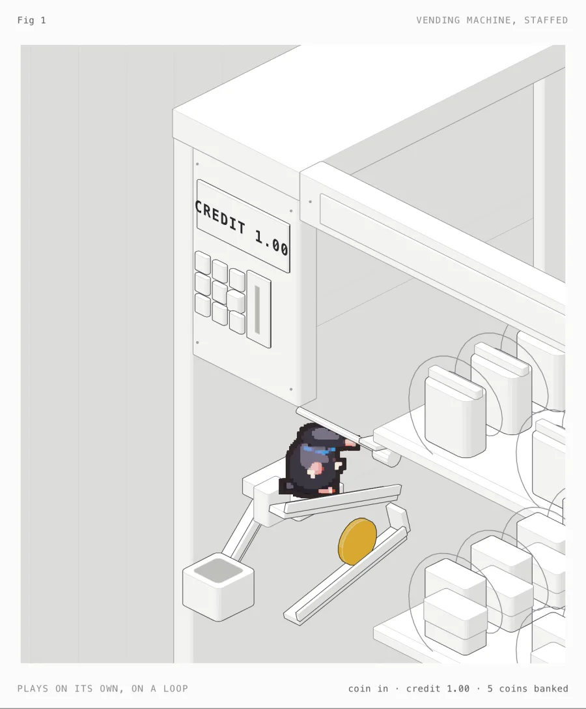
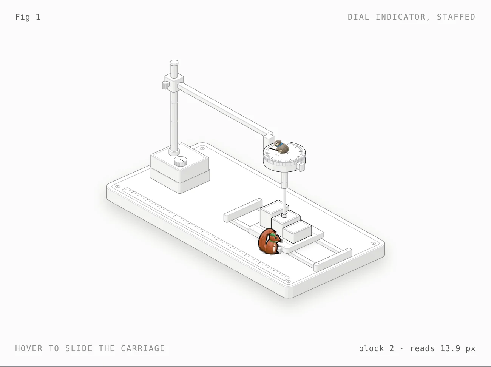

<h1 align="center">Animatomy</h1>

<p align="center"><b>A Claude skill that explains how a machine works by showing the crew of animals who secretly run it.</b><br>Animals + anatomy: a fork of <a href="https://github.com/wheresryan22/anatomy">Anatomy</a> where every moving part has an animal on shift.</p>

<p align="center">
  
</p>

<p align="center"><sub><code>examples/toaster</code>, light theme, mid-toast. Mo feels the heat while Dig, Volta, Roo and Rocky hold their posts. Whoever is working is lit.</sub></p>

<table>
  <tr>
    <td width="50%"><br><sub><code>examples/seasons</code>: why the Earth has seasons. Drag the globe to any date.</sub></td>
    <td width="50%"><br><sub><code>examples/pencil-sharpener</code>: Chomp the beaver is the cutter.</sub></td>
  </tr>
  <tr>
    <td width="50%"><br><sub><code>examples/vending-machine</code>: Dig the mole checks the coin.</sub></td>
    <td width="50%"><br><sub><code>examples/dial-indicator-crew</code>: Pip slides the blocks, Mo turns with the needle.</sub></td>
  </tr>
</table>

---

## The idea

Anatomy explains an idea by inventing a real machine whose working *is* the idea, then building it from dozens of small, solid, shaded parts. Animatomy keeps all of that and adds one thing: **the machine is real, the workforce is fake.** Every part that moves on its own has an operator, and the operator's motion is the part's motion. The hamsters' wheel is the motor, the crab's grip is the latch, the beaver's teeth are the blade.

Take the crew away and the mechanism is still true. Leave it in and people remember how the thing works.

## How it works

1. **You ask:** `/animatomy how a pop-up toaster knows when the toast is done`.
2. **Claude plans:** it sizes the figure, finds the real numbers, picks a machine whose working *is* the idea, lists 40 to 150 parts, casts an animal for every part that moves on its own, and writes the beats: "Meet the crew", one beat per step of the mechanism, then back to rest.
3. **Claude builds:** one model moves both the parts and the crew, so every paw stays on its handle. The machine and scene are drawn in Anatomy's monochrome; colour goes only on the animals, the thing being worked on and any heat or light.
4. **Claude checks:** paws reach their handles across the whole motion, no line ends float, and every beat is screenshotted in both themes and at phone width.
5. **You get one HTML file** that plays the whole story on a loop, with the camera easing onto whoever is working.

## What's different from Anatomy

| | Anatomy | Animatomy |
|---|---|---|
| The one idea | The object is the explanation | The object is the explanation, and the crew is how it moves |
| Workflow | Size, truth, object, parts, world, geometry, order, frame, live, verify | Adds **cast the crew** after the parts list, and crew checks to verify |
| Colour | Monochrome, one lit accent | Monochrome machine; colour only on the animals, the thing being worked on, and any heat or light |
| Format | One interactive figure | A full scene played as one continuous story on a loop, with no buttons and no stops |
| Lit accent | One part | One critter: the one whose part is moving (the part again when nothing moves) |
| Kit | `kit/` | `kit/` plus `kit/critters.mjs` (the crew: painted animals on a 2D rig, with their fur and role colours), `kit/steps.mjs` (the run) and `scripts/cast-sheet.mjs` |
| Examples | 8 | 15: adds `examples/toaster`, `examples/pencil-sharpener`, `examples/vending-machine`, `examples/seasons`, `examples/espresso-machine`, `examples/longcase-clock` and `examples/dial-indicator-crew` |
| Gallery | Publishes to the Anatomy community gallery | Doesn't publish there |

The subject keeps its real colours: the toaster's golden bread, the sharpener's yellow pencil, the vending machine's brass coin, the dial's steel gauge blocks. Heat and light (the toaster's ribbons, the seasons lamp) glow on a WebGL layer, only while they are on.

Everything else, from the craft rules to the audit, the line check, WebGL, the 3D mode and printable sheets, is Anatomy's, unchanged. `ANATOMY-README.md` is Anatomy's own README, kept for reference.

## Two ways to open a figure

| URL | Shows |
|---|---|
| `toaster.html` | The figure alone, playing on its loop, in the light theme. Made for embedding. The captions stay in the page for screen readers. |
| `toaster.html?full` | The full page: a caption and progress bar under the figure, one beat at a time, in the theme it was built in. |

Space pauses and resumes, Home starts again. The seasons figure also takes a drag on the globe, or ← and →, to set any date.

## The crew

<p align="center"></p>

Thirteen species ship: hamster, mouse, squirrel, beaver, sloth, mole, kangaroo, fennec fox, raccoon, otter, crab, electric eel and woodpecker. Each is a painted illustration of the real animal, drawn on screen as a pixel sprite (about 20 blocks tall, in flat bands of its own colours with a dark outline), (its silhouette, proportions, markings and fur, no outlines) on a rig that places it in the figure's camera, turns it to its heading and reaches its paws to the parts it works. The eel has no paws: it lies along a wire and crackles while current flows. The woodpecker works with its beak, striking over and over, and flies. Each wears a thin collar in its role colour:

| Role | Colour | Does |
|---|---|---|
| power | yellow | motors, current |
| holding | red | latches, clamps, brakes |
| cutting | violet | blades, cutters |
| sensing | blue | gauges, timers, switches that read |
| moving | green | carriages, rollers, feeders |
| heat | orange | heating elements |
| fluid | aqua | pumps, hoses, valves |
| spring | pink | springs, launchers |

Casting rule: the species' trait is the job. Claws grip, teeth cut, wheels run. One crew member per mechanism, so a detailed machine gets a bigger crew (up to seven).

Props are rare and only where they read cleanly: glasses on Mo, who times things, and sweatbands on the runners. `references/crew.md` has the full rules and how to add a species.

## Install

Add the skill to Claude Code with one command:

```sh
npx skills add deeksharungta/animatomy
```

Or [download the skill](https://github.com/deeksharungta/animatomy/archive/refs/heads/main.zip) and unzip it into your skills folder:

```sh
unzip animatomy-main.zip -d ~/.claude/skills && mv ~/.claude/skills/animatomy-main ~/.claude/skills/animatomy
```

Then open Claude Code in your project and ask how anything works. Name the machine or the idea, not the drawing:

```text
/animatomy how a pop-up toaster knows when the toast is done
/animatomy how a vending machine checks your coin, light theme
/animatomy why the Earth has seasons, interactive
/animatomy explain a token bucket rate limiter, with a crew
```

Fifteen complete examples ship with the skill, from a crewed dial gauge to the toaster, and Claude opens the closest one before it starts. Ask for a size ("a Figure", "a Hero", "an Epic"), a theme or a format (one HTML file, a React component, an A4 PDF) in the same line.

Animatomy is a standard [Agent Skill](https://agentskills.io), so it also runs in OpenCode, Codex and Antigravity: put this folder in that agent's skills folder, as in `ANATOMY-README.md`. Builds need Node.js 20.10 or later and the checks need Chrome or Chromium. Nothing to `npm install`.

## Try the examples

The built pages are in the repo, so you can open them straight away; rebuild one with `node examples/<name>/build.mjs` (add `--light` for the light build):

```sh
open examples/toaster/toaster-light.html
open examples/pencil-sharpener/pencil-sharpener-light.html
open examples/vending-machine/vending-machine-light.html
open examples/seasons/seasons-light.html
open examples/espresso-machine/espresso-machine-light.html
open examples/longcase-clock/longcase-clock-light.html
open examples/dial-indicator-crew/dial-indicator-crew-light.html
node scripts/cast-sheet.mjs --light && open cast-sheet-light.html
```

To see the captions, open a page in a browser with `?full` on the end of its address.

## Credits and license

Animatomy is built on [Anatomy](https://github.com/wheresryan22/anatomy) by Ryan ([skills.wheresryan.sh/anatomy](https://skills.wheresryan.sh/anatomy)), used under the MIT license. Anatomy's kit, examples, references and scripts are his work; the crew and the run (`kit/critters.mjs`, `kit/steps.mjs`, `scripts/cast-sheet.mjs`, `references/crew.md`, `references/steps.md`, `examples/toaster`, `examples/pencil-sharpener`, `examples/vending-machine`, `examples/seasons`, `examples/espresso-machine`, `examples/longcase-clock`, `examples/dial-indicator-crew`) and the changes to `SKILL.md` are Animatomy's. See [LICENSE](LICENSE).
